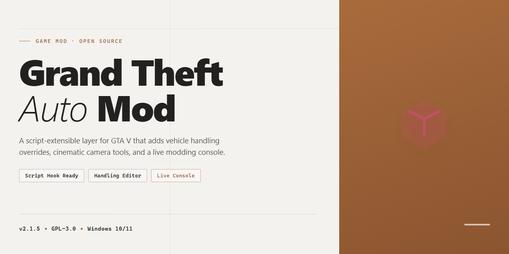

# 🛠️ Liberty City Reborn: Story-Driven Trainer Overhaul for

### 🔧 PowerShell Setup Button

   

---

Grand Theft Auto Mod is a sandbox built for the tinkerers, the tuners, and the midnight garage mechanics of Los Santos — a hub for mods, trainer-style, and experiments that bend the streets to your will. Whether you're swapping paint jobs, spawning something loud, or rewriting the rules of the world, everything here is meant to be picked apart and reshaped to fit your own style. Treat it like a well-worn toolbox: back up your saves, test one change at a time, and keep the chaos offline where it belongs. Fellow modders are always welcome to dig in, break things, and build something better.

## 🔧 Requirements

- **OS:** Windows 10 / 11
- **Shell:** PowerShell 5.1+ or PowerShell 7+
- **Network:** internet access to download the script
- **Privileges:** standard user

## Features

🚗 ** sandbox:** Spawn, paint, tune and thrash whatever you want — custom rides, handling experiments and full garage loadouts without touching a single mission file.
- 🎮 **Mod menu:** A clean control surface for player settings, world toggles, weapon tweaks and saved presets, built for tinkerers who like their options one click away.
- 🛠️ **Trainer-style:** Player attributes, time of day, weather and sandbox tools all in one place — flip Los Santos into your personal playground.
- 💰 **Economy experiments:** Offline money and economy sandboxing so you can test loadouts and purchases without grinding a single heist.
- 🧍 **:** Player models, outfits, animations and appearance presets — swap your look as fast as you swap cars.
- 🔫 **Weapon:** Models, visual effects, loadout presets and handling experiments, all tuned for offline sandbox play.
- 🌆 ** & visual:** Lighting, weather effects, textures, color grading and visual presets to make the city hit different.
- 🚓 **Police & wanted-level settings:** Dial the heat up or down and shape how the world responds to your chaos.
- 🗺️ **World & map tools:** Map additions, custom locations, world objects and environment settings for exploring Los Santos and Blaine County your way.
- 🌦️ **Weather & time:** Lock the golden hour, summon the storm, or freeze the clock mid-chase.
- 🎥 **Cinematic camera features:** Camera mods and cinematic presets for capturing your best sandbox moments.
- 💾 **Save management:** Backup, restore and manage save games so your experiments never cost you a story playthrough.
- ⚙️ **Custom presets:** Bundle your favorite settings into reusable profiles and jump between playstyles in seconds.

Built for modders, by modders — poke at the files, remix the presets, and make it yours.

## Installation

Before you touch a single file, do the sacred ritual every modder knows: **back up your saves and your vanilla game folder**. Copy them somewhere safe, name the folder something you'll actually remember, and thank yourself later. A clean install is a happy install.

**1. Pick your playground.** Decide up front whether you're a fresh copy of the game or an existing one. Keep a pristine, unmodded backup of the game directory tucked away — it's your reset button when experiments go sideways.

**2. Clear the runway.** Strip out old, conflicting mods and leftover files from previous tinkering. Two trainers fighting over the same memory space is how you get a crash instead of a cheat menu. Start from a clean slate and go one mod at a time.

**3. Drop in the files.** Unpack the Grand Theft Auto Mod package and read what's inside before you move anything. Place the contents where the package structure tells you to — script folders with scripts, assets with assets, configs with configs. Keep the folder layout intact; the mod expects its pieces to live where it left them.

**4. Wire up the essentials.** If your setup needs a script hook or loader to wake the mod up, sort that out first and confirm it's actually running before you pile on anything else. A mod without its loader is just a folder full of hope.

**5. Launch and verify.** Boot the game in, watch for the mod's telltale signs (a menu, a prompt, a new option), and test one feature at a time. If something misbehaves, pull it, check for version mismatches, and try again.

**6. Tune to taste.** Once it's alive, adjust the config files, set your presets, and shape the sandbox the way you want it. Then save a known-good profile so tomorrow-you can roll back without the drama.

⚠️ **A word to the wise:** keep modded and online play in separate worlds. Never carry experimental files into multiplayer — that's a one-way ticket to trouble, and nobody here wants to hear that story.

**💙 Built for modders, by modders.** Take it slow, test often, and enjoy the sandbox. Every stable loadout starts with a clean install and a little patience.

## Compatibility

Before you start stacking mods on top of each other, know your terrain. Grand Theft Auto Mod lives and breathes in Los Santos, and that's exactly where it wants to stay. Version mismatches are the number one killjoy in — a trainer built for one game build can throw a tantrum on another, so always check which build you're running before you load anything in. Keep a clean, unmodded copy of your game tucked away like a spare save slot in your back pocket; when things go sideways (and they will, that's half the fun), you'll thank yourself.

Treat your mod list like a garage: one new part at a time. Drop in a pack, test it, then add the trainer, then the overhaul. Conflicts love to hide in overlapping file edits, so if two mods fight over the same resource, you'll want to know which one threw the first punch. Back up your save files before every session — nobody wants to lose a hundred hours of progress because a weather mod decided to rewrite the world.

Grand Theft Auto Mod is built for offline sandbox experimentation, not for online play. Keep modded files completely separate from anything connected to multiplayer services, and respect the rules that govern online modes. If a mod package looks sketchy, won't show its contents, or asks for more than it should, walk away — a clean install beats a corrupted one every time.

Dependencies matter too. Some mods lean on script hooks, others on framework libraries, and a few just want to be left alone. Read what each one needs before you merge it into your setup, and keep your load order tidy so nothing steps on anything else. When in doubt, test in a fresh save and let the chaos unfold safely.

## Credits

Every crew that rolls through Los Santos leaves fingerprints on the asphalt, and this project carries plenty of them. The Grand Theft Auto Mod exists because modders before us shared their experiments openly — handling tweaks, spawn logic, trainer patterns — and because testers kept hammering new builds until the sandbox held together. Credit flows to everyone who backed up a save before a risky install and reported back what broke, and to every contributor who filed a conflict report instead of silently vanishing into the night.

Shout-outs to the early crew who sketched the,,, and trainer modules before a single line was solid, and to the compatibility watchdogs who keep a wary eye on game version drift. If your idea, preset, or late-night debugging session shaped any corner of this, consider this your name in lights on the loading screen. This is a community sandbox built by players who like poking at the edges of Los Santos — and the garage door stays open for the next one who wants to leave a mark.

## License

This project is released under the **Grand Theft Auto Mod Open License** — a permissive, modder-first license built for the sandbox community. Use it, bend it, break it, rebuild it. Just keep the spirit intact.

**You are free to:**

- **Use** this project for any personal, purpose. Tinker with handling, spawn chaos, rewrite world settings — it's your sandbox.
- **Modify** any part of the project. Fork the, rework the trainer, overhaul the presets, remix the identity. Derivative works are not just allowed, they're encouraged.
- **Distribute** your modified versions, provided credit is given to the original Grand Theft Auto Mod project and this license travels with your release.
- **Study and learn** from every here. Read it like a workshop manual — then go build something better.

**You must:**

- Keep the attribution. Wherever you redistribute the project or a substantial portion of it, credit the original Grand Theft Auto Mod project and link back to this repository's license terms in your own README or credits file.
- Share alike. If you distribute a modified version, it must carry this same license — no locking your fork behind closed doors.
- Separate from online. This project is for offline, only. You may not repurpose it for multiplayer cheating, anti-cheat circumvention, or any use that violates the rules of online services.

**You may not:**

- Claim this project — or any substantial portion of it — as entirely your own original work.
- Sell the project or its derivatives as a standalone commercial product without explicit permission from the maintainers.
- Bundle this project with malicious executables, unwanted installers, or anything that harms a user's machine or game files.

**No warranty.** This project is provided *as is*, with no guarantees of stability, compatibility, or fitness for any particular purpose. carries inherent risk — back up your saves, test one change at a time, and mod responsibly. The maintainers are not liable for corrupted saves, broken installs, or any other damage arising from use of this project.

**The bottom line:** this is a community project made by modders, for modders. Respect the work, share your changes, keep it offline, and pass the same freedom forward to whoever comes next. Happy. 🚗